  

Lately I've mostly been building [Gelabber](https://github.com/Till-und-Scholler-AI-slop/Gelabber), a self-hosted chat, voice and screen-sharing server. Around it: [bookclub](https://github.com/rafiistcool/bookclub), plugins for [Omarchy](https://omarchy.org), and small tools around AI coding agents.

  
  

### Recently pushed

<!-- RECENT:START -->
- **[Gelabber](https://github.com/Till-und-Scholler-AI-slop/Gelabber)** · Self-hosted chat, voice & live screenshare (a calm Discord alternative) · `Rust`
- **[bookclub](https://github.com/rafiistcool/bookclub)** · A private book club for 2–5 people: invite-only shelves, one shared pick, a spoiler-shielded diary · `Rust`
- **[omarchy-protonvpn](https://github.com/rafiistcool/omarchy-protonvpn)** · Omarchy bar plugin for Proton VPN: toggle, country and city picker · `QML`
- **[tillhome](https://github.com/rafiistcool/tillhome)** · Static homepage portal for tillhome.de — YAML-configurable subdomain link hub · `TypeScript`
- **[omarchy-wireguard](https://github.com/rafiistcool/omarchy-wireguard)** · WireGuard profiles and configuration import for the Omarchy shell · `Python`
<!-- RECENT:END -->

  

  
  
  
  
  
  
  
  
  
  
  
  
  
  
  
  
  
  
  
  
  

