  

Lately I've mostly been writing plugins for [Omarchy](https://omarchy.org), tuning Hyprland, and building small tools around AI coding agents.

  
  

### Recently pushed

<!-- RECENT:START -->
- **[tillhome](https://github.com/rafiistcool/tillhome)** · Static homepage portal for tillhome.de — YAML-configurable subdomain link hub · `TypeScript`
- **[omarchy-wireguard](https://github.com/rafiistcool/omarchy-wireguard)** · WireGuard profiles and configuration import for the Omarchy shell · `Python`
- **[omarchy-kb-layout](https://github.com/rafiistcool/omarchy-kb-layout)** · Omarchy plugin to toggle Hyprland between US and German keyboard layouts · `Python`
- **[omarchy-protonvpn](https://github.com/rafiistcool/omarchy-protonvpn)** · Omarchy bar plugin for Proton VPN: toggle, country and city picker · `QML`
- **[ferrite](https://github.com/rafiistcool/ferrite)** · A modern terminal wrapper with built-in AI assistance — written in Rust · `Rust`
<!-- RECENT:END -->

  

  
  
  
  
  
  
  
  
  
  
  
  
  
  
  
  
  

